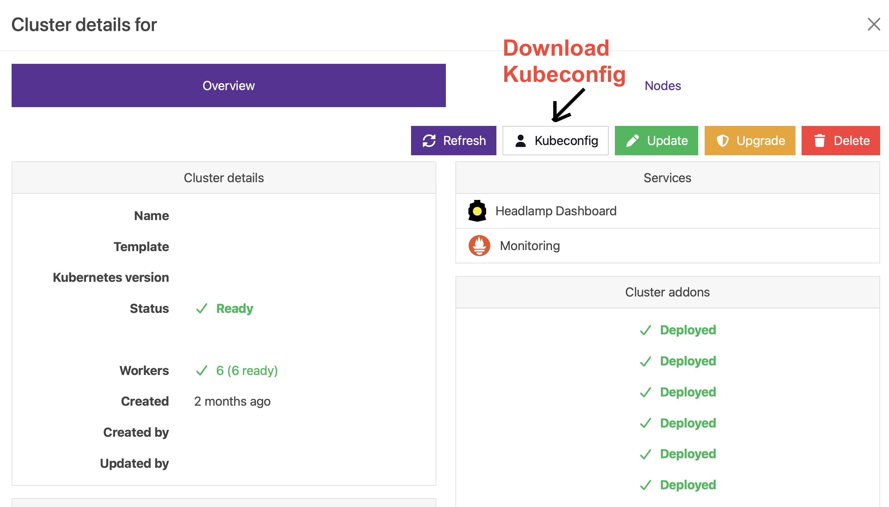

# The Durham Azimuth Cloud Facility (DACF)

The Durham Azimuth Cloud Facility (DACF) is a self service web portal hosted on COSMA, giving researchers access to interactive science platforms running on Durham's on premise OpenStack cloud.  

The motivation for using Azimuth is to deliver the latest high performance cloud tools to researchers in a single web platform, maximising their science while reducing the complexity of configuring scientific computing environments.

Projects with accounts on Azimuth can manage their own nodes, Slurm clusters, Kubernetes clusters, KubeFlow environments and more, providing users more flexibility to develop their own codes in a clean pre-configured cloud resource. 

It can also work with Moodle web framework where reserachers can deliver their courses to community. 

# Azimuth Platforms 

- **Argo CD**  - offers an environment for GitOps based management of applications deployed on Kubernetes.
- **BinderHub** – delivers a multi user Jupyter notebook environment.
- **DaskHub** – extends the multi user Jupyter environment with Dask integration.
- **Jupyter Notebook** – offers a web based interactive environment for exploring Jupyter notebooks from an existing GitHub, GitLab, Zenodo or Figshare repository, powered by repo2docker. 
- **JupyterHub** – provides a multi user Jupyter notebook environment. 
- **KubeFlow** – provides a machine learning environment on Kubernetes for building and running ML workflows.
- **Kubernetes cluster** – deploys a Kubernetes cluster with optional addons, including monitoring and ingress.
- **Linux Workstation** – provides secure web access to an Ubuntu 22.04 Linux workstation.
- **R Studio Server** – runs an R Studio Server instance for easy web based access.
- **Slurm** – provides Batch cluster running the Slurm workload manager, the Open OnDemand web interface, and custom monitoring.

# Kubernetes Access

The Azimuth Cloud Portal allow you to deploy Kubernetes clusters using `kubectl` and `k9s`.

To access a Kubernetes cluster for debugging,logs etc. you need an account on the [Azimuth portal](https://portal.azimuth.cosma.dur.ac.uk). From Azimuth portal, click details of Kubernetes cluster to download kubeconfig to your local machine. It should looks like something like this:



You will also need the following tools installed locally:

- `kubectl` – required to interact with the cluster.
- `helm` – used to manage Helm charts.
- `k9s` – optional, but recommended to see live logs and helm charts.

You can check that evreything is installed correctly with:

```bash
kubectl version --client
helm version
k9s version
```

To interact with a cluster, point your terminal at the downloaded kubeconfig file:

```bash
export KUBECONFIG=~/.kube/ml-intro.yaml
```

You can check that access works:

```bash
kubectl cluster-info
kubectl get nodes
```

Example output:

```text
NAME                                  STATUS   ROLES           VERSION   INTERNAL-IP
ml-intro-control-plane-65mpf          Ready    control-plane   v1.34.6   x.x.x.x
ml-intro-control-plane-l4rv2          Ready    control-plane   v1.34.6   x.x.x.x
ml-intro-control-plane-ntm9r          Ready    control-plane   v1.34.6   x.x.x.x
ml-intro-ml-intro-69ngd-ckrhh         Ready    worker          v1.34.6   x.x.x.x
```

---

## Using K9s

`k9s` is a terminal user interface for Kubernetes. It is useful for checking pods, logs, deployments, services, config maps and secrets.

```bash
k9s
```

> **Tip:** Inside `k9s`, press `:n` and return or press `/` and return to see the running pods.

## Checking the Current Context

Kubernetes commands are run against the current context in your kubeconfig.

```bash
kubectl config current-context
```

List all available contexts:

```bash
kubectl config get-contexts
```

Switch context:

```bash
kubectl config use-context <context-name>
```

Example:

```bash
kubectl config use-context ml-intro-admin@ml-intro
```

## Multiple Kubernetes Clusters

You may have access to more than one Kubernetes cluster, for example a GPU cluster and an ML cluster. Kubernetes uses kubeconfig files to store cluster connection details, users, namespaces and contexts.

Kubernetes can merge multiple kubeconfig files listed in the `KUBECONFIG` environment variable, separated by colons:

```bash
export KUBECONFIG=$HOME/.kube/config:$HOME/ml-intro.yaml:$HOME//test-cluster.yaml
```

You can then move between clusters using `kubectl config use-context`, as shown above.

# Notes for Developers

This section is intended for course developers and administrators who maintain JupyterHub deployments on Azimuth. In addition to the tools listed under [Kubernetes Access](#kubernetes-access), you will need `docker` and the `flux` CLI.

## JupyterHub Configuration

Each user's Jupyter notebook server runs as a Kubernetes pod in the `jupyterhub` namespace. Deployments are managed reproducibly via Helm charts, and you can extend the resources available to users by building different Docker images. For more details, see the [Zero to JupyterHub configuration reference](https://z2jh.jupyter.org/en/stable/resources/reference.html).

The commands below are useful for debugging which image a notebook pod is running.

First, find the notebook pod. User pods are named `jupyter-<username>`:

```bash
kubectl -n jupyterhub get pods
POD=jupyter-<username>
```
Alternatively, if only one user pod is running, you can set `POD` automatically:

```bash
POD=$(kubectl -n jupyterhub get pods -o name | grep jupyter- | sed 's|pod/||')
```
Check which image is running:

```bash
kubectl -n jupyterhub get pod "$POD" \
  -o jsonpath='{.spec.containers[?(@.name=="notebook")].image}{"\n"}'
```

Verify the image digest:

```bash
kubectl -n jupyterhub get pod "$POD" \
  -o jsonpath='{.status.containerStatuses[?(@.name=="notebook")].imageID}{"\n"}'
```

Check where volumes are mounted in the single-user pod:

```bash
kubectl -n jupyterhub get pod "$POD" \
  -o jsonpath='{range .spec.containers[?(@.name=="notebook")].volumeMounts[*]}{.name}{" -> "}{.mountPath}{"\n"}{end}'
```

> **Important:** Please note that if the storage mounted as a Persistent Volume Claim you have to move your Jupyter server config to somewhere else from the directory you put in. Because the configs will be hidden by mounted volume. So, it would not work what you apply into the helm chart values.

> **Note:** Jupyterhub configurations should generally be provided as explicit assignments rather than by setting existing configuration values (e.g. `getattr(..., "tornado_settings")`). Please avoid relying on existing runtime values inside `jupyter_server_config.py`; instead assign complete configuration objects directly (e.g. `c.ServerApp.tornado_settings = {...}`).


### Creating Profiles for Courses

If you are developing a new course, you have to build kernels on your local machine to deploy on Azimuth. To do that you have to create a directory having Dockerfile to pass your kernels along side requirtments and course materials. 

```bash
docker build -t quay.io/<username>/<image>:<tag> .
docker push quay.io/<username>/<image>:<tag>
```

_Note:_ If you are using MacOs ARM procceses you have to use `buildx` to create cross platform working images. 

After building and pushing the image to a container registry (e.g. Quay), then reference the image should be in `apps/jupyterhub/values.yaml`. 
You have to access that repo to be able to commit your deployment.

```bash
git add .
git commit - m "Image added with <tag>"
git push origin
```

Once the configuration is committed and you need to deploy via FluxCD:

```bash
flux get helmreleases -A
flux reconcile source git flux-system -n flux-system
flux reconcile kustomization apps -n jupyterhub --with-source
flux reconcile helmrelease jupyterhub -n jupyterhub --force
```

The new profile becomes available to users when they launch JupyterHub from Moodle.

# Limitations

The system of Azimuth cloud still under the development phase - meaning that some issues/bugs in JupyterHub may be present. Please do let us know if you come across anything odd deploying your course on Azimuth cloud.
