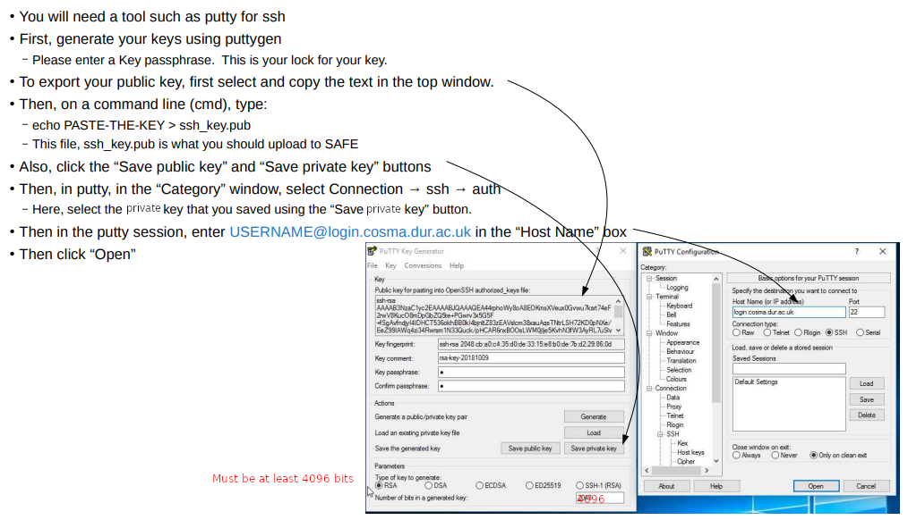

# Generating a SSH key

To log in to COSMA you need an SSH key pair, as well as your COSMA password.
A key pair has two parts:

- **The private key** stays on your own computer.  Anyone who has it, and its
  passphrase, can log in as you, so never copy it to other systems, email it,
  or keep it anywhere that is not secure.
- **The public key** (the file ending `.pub`) is safe to share.  You upload it
  to SAFE, and COSMA uses it to check that you hold the private key.

You only need one key for all the COSMA login nodes.  If you use several
computers, it is better to make a separate key on each one and upload them
all, rather than copying a private key between computers.

## Making a key

The same command works on Linux, macOS and Windows 10 or 11 (in PowerShell or
the command prompt):

```
ssh-keygen -t ed25519 -C "cosmakey-mylaptop"
```

`-C` adds a comment to help you recognise the key later, for example on SAFE.
`ssh-keygen` then asks two things:

1. **Where to save the key.**  Press Enter for the default:
   `~/.ssh/id_ed25519` on Linux and macOS, and
   `C:\Users\YOURNAME\.ssh\id_ed25519` on Windows.  If you choose another name,
   tell SSH where it is with `ssh -i` or `IdentityFile` (see
   [saving SSH configuration](ssh.md#saving-ssh-configuration)).
2. **A passphrase.**  Please use a strong one: weak passphrases let attackers
   into HPC systems across Europe, China and the USA in 2020.  Around 16
   characters is good, for example several words strung together.  The
   passphrase should be different from your COSMA password.

This creates two files: `id_ed25519` (the private key) and `id_ed25519.pub`
(the public key).

Use an ed25519 key if you can.  If your SSH is too old to make one, use a
4096-bit RSA key instead:

```
ssh-keygen -t rsa -b 4096 -C "cosmakey-mylaptop"
```

Older key types, such as DSA, are not recommended and may be refused.

## Uploading the public key to SAFE

1. Show the public key, and copy all of it (it is a single line starting
   `ssh-ed25519`):
   - Linux or macOS: `cat ~/.ssh/id_ed25519.pub`
   - Windows: `type %USERPROFILE%\.ssh\id_ed25519.pub` in the command prompt,
     or `Get-Content ~\.ssh\id_ed25519.pub` in PowerShell
2. Log in to [SAFE](https://safe.epcc.ed.ac.uk/dirac), select "Login accounts",
   then your COSMA account.
3. Click "Add credential", and paste or upload the public key.  Windows may
   show the `.pub` file as a Microsoft Publisher file; it is not one, and
   uploading it is fine.

Never upload the private key, the file without `.pub`.

A new key has to be accepted by cosma-support before it works, so it may not
work straight away.  Once it does, see [SSH access](ssh.md) to log in.

## Looking after your key

- **Keep the private key private.**  SSH refuses to use a private key that
  other users can read.  On Linux and macOS, run:

  ```
  chmod 700 ~/.ssh
  chmod 600 ~/.ssh/id_ed25519
  ```

- **Change the passphrase** without making a new key:
  `ssh-keygen -p -f ~/.ssh/id_ed25519`.
- **Check which key is which**: `ssh-keygen -l -f ~/.ssh/id_ed25519.pub`
  prints the key's fingerprint and comment, which you can compare with the
  key on SAFE.
- **Avoid typing the passphrase every time** with an SSH agent: see
  [storing your key passphrase](ssh.md#storing-your-key-passphrase).
- **If you forget the passphrase**, it cannot be recovered: make a new key and
  upload it to SAFE.
- **If the private key may have been copied by someone else**, for example
  because a laptop was lost, contact cosma-support straight away so that the
  key can be removed, and upload a new one.

The same key can also be used for other services, such as
[GitHub](https://docs.github.com/en/authentication/connecting-to-github-with-ssh).

## Windows

The method most likely to work (in our experience) is to use WSL
(Windows Subsystem for Linux), which gives you a Linux command line.
To install it, open the command prompt and run `wsl --install`, then
restart (once it has finished).  Open "Ubuntu" from the start menu,
create a user, and follow the steps above as for Linux.  WSL has its
own `~/.ssh` directory, separate from Windows: a key made in one is
not seen by the other.

Alternatively, the built-in OpenSSH in Windows 10 and 11, used above,
is the simplest choice.  The [Windows 10 SSH
guide](files/COSMAWindows10sshDocumentation.pdf) shows the same steps
with screenshots.

In summary:

1. Hit the windows key, and type "cmd"
2. In the cmd window type `ssh-keygen -t ed25519 -C "cosmakey"`
3. Hit return for the default options (key filename, etc), and enter a passphrase (twice) when requested.
4. The key will be in a .ssh folder.  You need to upload this to [SAFE](https://safe.epcc.ed.ac.uk/dirac), select login accounts -> COSMA, and then the "Add credential" button.  Upload the public part (.pub), which will probably try to identify itself as a Microsoft Publisher file (it isn't).
5. Once you have a welcome email from cosma, try: ssh USERNAME@login.cosma.dur.ac.uk
6. It should ask for you key passphrase.  It will then ask for your COSMA password, which will be in the welcome email.  You will need to enter this twice: once to login and then once to start the password change.
7. Enter a new password twice.


PuTTY uses its own key format, and we often cannot get it working, so we
recommend the built-in OpenSSH or WSL instead.  If you need PuTTY, make the key
with PuTTYgen and upload the public key it shows, in OpenSSH format.



## Android

On Android, use an SSH app such as Termux or JuiceSSH.  Make the key pair in
the app, and upload its public key to SAFE as above.
